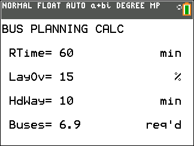

# BusPlan CE

Estimates the number of buses required for a route from round-trip time, layover percentage, and headway.

## Compatibility and installation

Target: TI-84 Plus CE, using TI-BASIC. This import has not been tested on calculator hardware.

Transfer [BUSPLAN-CE.8xp](BUSPLAN-CE.8xp) with TI Connect CE, then run **BUSPLAN** from the calculator’s PRGM menu. The transfer filename and the name shown on the calculator can differ.

## Usage

1. Enter round-trip driving time in minutes.
2. Enter layover as a percentage of driving time.
3. Enter the desired headway in minutes.
4. Read the calculated bus requirement.

Example: 60 minutes, 15% layover, and a 10-minute headway produce 6.9 buses.

## Notes

The result is rounded to one decimal place; it is not rounded up to a whole fleet size. The original documentation says working variables are cleared on exit.

## Screenshots

## Original documentation and release

- [README.txt](docs/README.txt)
- [Original ZIP](../../originals/BusPlan%20CE.zip)

The files above are preserved from the original release. This README is an archive guide; original documentation may contain older names, links, or claims.

## License

Covered by the repository’s [MIT license](../../LICENSE).
