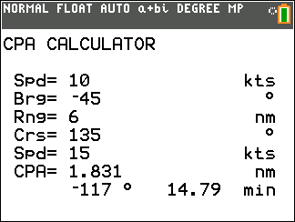

# CPA CE

Calculates closest point of approach between two vessels using constant courses and speeds.

## Compatibility and installation

Target: TI-84 Plus CE, using TI-BASIC. This import has not been tested on calculator hardware.

Transfer [CPA.8xp](CPA.8xp) with TI Connect CE, then run **CPA** from the calculator’s PRGM menu. The transfer filename and the name shown on the calculator can differ.

## Usage

1. Enter own-ship speed in knots.
2. Enter the contact bearing as a signed relative bearing (−180° to +180°).
3. Enter range in nautical miles.
4. Enter the contact’s true course in degrees and speed in knots.
5. Read CPA distance, signed relative bearing to CPA, and time to CPA in minutes.

## Notes

The model assumes own ship’s course is 000° true and both vessels maintain constant course and speed. The original documentation identifies this as version 1.0, created and last edited June 19, 2025.

## Screenshots

## Original documentation and release

- [readme_CPA.txt](docs/readme_CPA.txt)
- [Original ZIP](../../originals/CPA%20CE.zip)

The files above are preserved from the original release. This README is an archive guide; original documentation may contain older names, links, or claims.

## License

Covered by the repository’s [MIT license](../../LICENSE).
