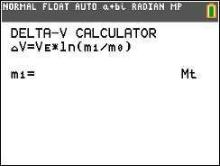
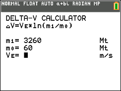
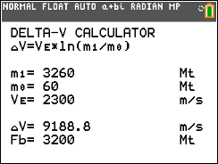

# Delta-V CE

Explores the ideal rocket equation using initial mass, final mass, and exhaust velocity.

## Compatibility and installation

Target: TI-84 Plus CE, using TI-BASIC. This import has not been tested on calculator hardware.

Transfer [DELTAVCE.8xp](DELTAVCE.8xp) with TI Connect CE, then run **DELTAV** from the calculator’s PRGM menu. The transfer filename and the name shown on the calculator can differ.

## Usage

1. Enter vehicle mass including fuel.
2. Enter final mass without fuel or other jettisoned mass.
3. Enter exhaust velocity in metres per second.
4. Read the calculated delta-v.

Use consistent mass units for both mass inputs.

## Notes

This is an idealized educational calculation; it omits effects such as atmospheric drag. The preserved README includes guidance about summing exhaust velocities for multiple engines; that guidance has not been validated and should not be treated as a general rule.

## Screenshots

## Original documentation and release

- [readme.txt](docs/readme.txt)
- [Original ZIP](../../originals/Delta-V%20CE.zip)

The files above are preserved from the original release. This README is an archive guide; original documentation may contain older names, links, or claims.

## License

Covered by the repository’s [MIT license](../../LICENSE).
