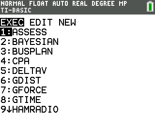
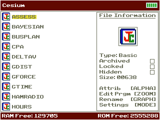
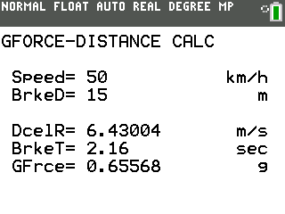

# GDist CE

Calculates deceleration, stopping time, and g-force from initial velocity and stopping distance.

## Compatibility and installation

Target: TI-84 Plus CE, using TI-BASIC. This import has not been tested on calculator hardware.

Transfer [GDIST.8xp](GDIST.8xp) with TI Connect CE, then run **GDIST** from the calculator’s PRGM menu. The transfer filename and the name shown on the calculator can differ.

## Usage

Enter the initial velocity and stopping distance using the SI units shown by the program, then read the deceleration, time, and g-force results.

## Notes

One of three related braking calculators: GDist uses distance, GForce uses g-force, and GTime uses time as the second known input.

## Screenshots

## Original documentation and release

- [readme.rtf](docs/readme.rtf)
- [Original ZIP](../../originals/GDist%20CE.zip)

The files above are preserved from the original release. This README is an archive guide; original documentation may contain older names, links, or claims.

## License

Covered by the repository’s [MIT license](../../LICENSE).
