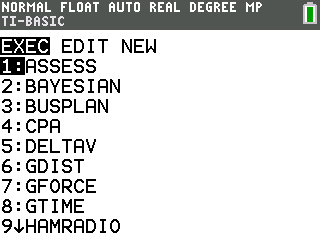
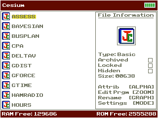
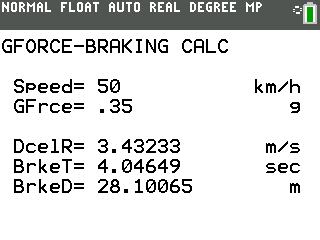

# GForce CE

Calculates deceleration, stopping distance, and stopping time from initial velocity and desired g-force.

## Compatibility and installation

Target: TI-84 Plus CE, using TI-BASIC. This import has not been tested on calculator hardware.

Transfer [GFORCE.8xp](GFORCE.8xp) with TI Connect CE, then run **GFORCE** from the calculator’s PRGM menu. The transfer filename and the name shown on the calculator can differ.

## Usage

Enter the initial velocity and desired braking g-force using the units shown by the program, then read the deceleration, distance, and time results.

## Notes

The original README refers to GFORCECE.8xp. The actual file in this release is GFORCE.8xp; transfer that file. Related programs: GDist and GTime.

## Screenshots

## Original documentation and release

- [readme.rtf](docs/readme.rtf)
- [Original ZIP](../../originals/GForce%20CE.zip)

The files above are preserved from the original release. This README is an archive guide; original documentation may contain older names, links, or claims.

## License

Covered by the repository’s [MIT license](../../LICENSE).
