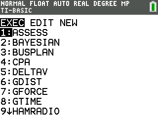
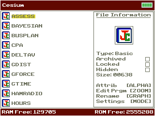
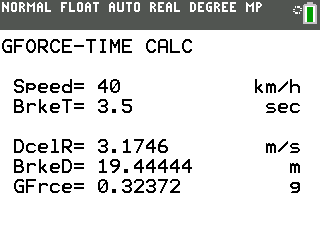

# GTime CE

Calculates deceleration, stopping distance, and g-force from initial velocity and stopping time.

## Compatibility and installation

Target: TI-84 Plus CE, using TI-BASIC. This import has not been tested on calculator hardware.

Transfer [GTIME.8xp](GTIME.8xp) with TI Connect CE, then run **GTIME** from the calculator’s PRGM menu. The transfer filename and the name shown on the calculator can differ.

## Usage

Enter the initial velocity and stopping time using the SI units shown by the program, then read the deceleration, distance, and g-force results.

## Notes

Related programs: GDist and GForce.

## Screenshots

## Original documentation and release

- [readme.rtf](docs/readme.rtf)
- [Original ZIP](../../originals/GTime%20CE.zip)

The files above are preserved from the original release. This README is an archive guide; original documentation may contain older names, links, or claims.

## License

Covered by the repository’s [MIT license](../../LICENSE).
