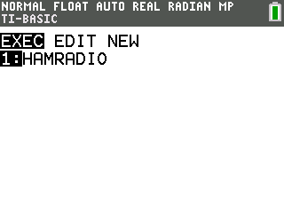

# HAMRadio CE

Calculates frequency, wavelength, and photon energy and displays a radio-band classification.

## Compatibility and installation

Target: TI-84 Plus CE, using TI-BASIC. This import has not been tested on calculator hardware.

Transfer [HAMRADIOCE.8xp](HAMRADIOCE.8xp) with TI Connect CE, then run **HAMRADIO** from the calculator’s PRGM menu. The transfer filename and the name shown on the calculator can differ.

## Usage

1. Select frequency, wavelength, or energy from the menu.
2. Enter frequency in MHz, wavelength in metres, or photon energy in joules.
3. Read the other two properties and the displayed band classification.

## Notes

The documentation describes the wave equation c = fλ and Planck’s equation E = hf, using c = 3 × 10⁸ m/s and h = 6.63 × 10⁻³⁴ J·s. Its band labels are preserved in the original documentation; they are program classifications, not a regional amateur-radio allocation reference.

## Screenshots

## Original documentation and release

- [README.txt](docs/README.txt)
- [Original ZIP](../../originals/HAMRadio%20CE.zip)

The files above are preserved from the original release. This README is an archive guide; original documentation may contain older names, links, or claims.

## License

Covered by the repository’s [MIT license](../../LICENSE).
