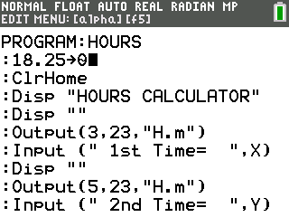
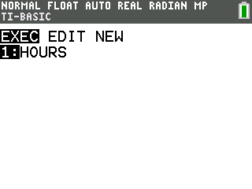

# Hours CE

Calculates hours worked and pay from start and end times entered in H.MM format.

## Compatibility and installation

Target: TI-84 Plus CE, using TI-BASIC. This import has not been tested on calculator hardware.

Transfer [HOURSCE.8xp](HOURSCE.8xp) with TI Connect CE, then run **HOURS** from the calculator’s PRGM menu. The transfer filename and the name shown on the calculator can differ.

## Usage

1. Set the hourly wage by editing the first program line, which defaults to 18.25→θ.
2. Enter the start time in H.MM format, such as 8.30 for 08:30.
3. Enter the end time in the same format, such as 17.15 for 17:15.
4. Read hours worked in H.MM format and pay in dollars.

## Notes

H.MM is not decimal hours: .45 means 45 minutes. The calculation converts to decimal hours internally and rounds pay to cents. Overnight-shift handling is not documented.

## Screenshots

## Original documentation and release

- [README.txt](docs/README.txt)
- [Original ZIP](../../originals/Hours%20CE.zip)

The files above are preserved from the original release. This README is an archive guide; original documentation may contain older names, links, or claims.

## License

Covered by the repository’s [MIT license](../../LICENSE).
