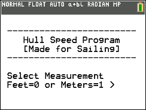
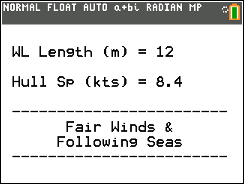
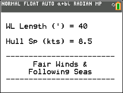

# Hull Speed CE

Calculates theoretical vessel hull speed from a length entered in feet or metres.

## Compatibility and installation

Target: TI-84 Plus CE, using TI-BASIC. This import has not been tested on calculator hardware.

Transfer [HULLSPDCE.8xp](HULLSPDCE.8xp) with TI Connect CE, then run **HULLSPD** from the calculator’s PRGM menu. The transfer filename and the name shown on the calculator can differ.

## Usage

Follow the program prompts to enter the vessel length in feet or metres and read the theoretical hull-speed result.

## Notes

The original README describes this as a theoretical calculation for sailing vessels. It does not provide a detailed input walkthrough; follow the units displayed by the program.

## Screenshots

## Original documentation and release

- [readme.txt](docs/readme.txt)
- [Original ZIP](../../originals/Hull%20Speed%20CE.zip)

The files above are preserved from the original release. This README is an archive guide; original documentation may contain older names, links, or claims.

## License

Covered by the repository’s [MIT license](../../LICENSE).
