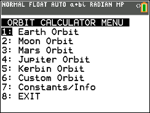
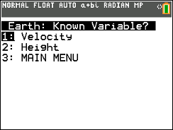
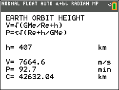
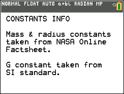

# Orbit CE

Explores circular-orbit calculations using orbital velocity or height, with preset and custom celestial bodies.

## Compatibility and installation

Target: TI-84 Plus CE, using TI-BASIC. This import has not been tested on calculator hardware.

Transfer [ORBITCE.8xp](ORBITCE.8xp) with TI Connect CE, then run **ORBIT** from the calculator’s PRGM menu. The transfer filename and the name shown on the calculator can differ.

## Usage

1. Choose Earth, the Moon, Mars, Jupiter, Kerbin, or CUSTOM.
2. For CUSTOM, enter mass, radius, and gravitational constant when prompted.
3. Choose the calculation using known orbital velocity or height.
4. Enter values in the metric units shown on screen and read the results.

## Notes

The model assumes a circular orbit and constant orbital speed. Kerbin is fictional. The original README explicitly states this release requires the CE display and will not display properly on a non-CE calculator.

## Screenshots

## Original documentation and release

- [readme.txt](docs/readme.txt)
- [Original ZIP](../../originals/Orbit%20CE.zip)

The files above are preserved from the original release. This README is an archive guide; original documentation may contain older names, links, or claims.

## License

Covered by the repository’s [MIT license](../../LICENSE).
