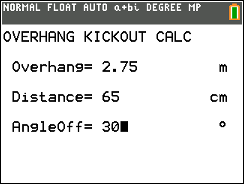
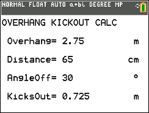

# Overhang CE (KICKOUT)

Calculates net lateral rear-overhang kickout for a vehicle turning through a given angle.

## Compatibility and installation

Target: TI-84 Plus CE, using TI-BASIC. This import has not been tested on calculator hardware.

Transfer [KICKOUT.8xp](KICKOUT.8xp) with TI Connect CE, then run **KICKOUT** from the calculator’s PRGM menu. The transfer filename and the name shown on the calculator can differ.

## Usage

1. Put the calculator in degree mode.
2. Enter rear overhang in metres.
3. Enter already-cleared distance in centimetres.
4. Enter the turn angle in degrees.
5. Read net additional kickout in metres.

Example: 2.75 m overhang, 65 cm clearance, and 30° produce 0.725 m.

## Notes

The original release is named Overhang CE.zip, but its folder, documentation, and calculator program use KICKOUT. The documented formula is O × sin(A) − D/100. The original documentation identifies version 1.0, created and last updated June 19, 2025.

## Screenshots

## Original documentation and release

- [readme_KICKOUT.rtf](docs/readme_KICKOUT.rtf)
- [Original ZIP](../../originals/Overhang%20CE.zip)

The files above are preserved from the original release. This README is an archive guide; original documentation may contain older names, links, or claims.

## License

Covered by the repository’s [MIT license](../../LICENSE).
