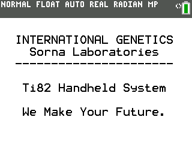
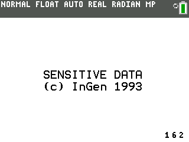
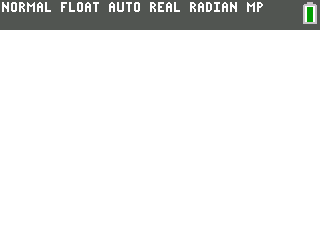
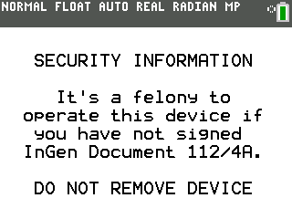

# SornaOS CE

A menu-driven fictional Sorna field terminal with company messages, dinosaur data, and simulated network failures.

## Compatibility and installation

Target: TI-84 Plus CE, using TI-BASIC. This import has not been tested on calculator hardware.

Transfer [SORNAOS.8xp](SORNAOS.8xp) with TI Connect CE, then run **SORNAOS** from the calculator’s PRGM menu. The transfer filename and the name shown on the calculator can differ.

## Usage

Run SORNAOS and use the menus to explore company messages, assignments, dinosaur count/status/tracking, incident reporting, and security information. Use Exit to end the session.

## Notes

This is a TI-BASIC fictional terminal simulation, not a replacement calculator operating system. The accompanying reconstruction and archival accounts are in-universe storytelling involving Isla Sorna, InGen, and BioSyn. Network attempts are simulated; some data are randomized. Both original documents are preserved under docs/ with their original .md.md filenames.

## Screenshots

## Original documentation and release

- [ARCHIVAL_NOTE.md.md](docs/ARCHIVAL_NOTE.md.md)
- [README.md.md](docs/README.md.md)
- [Original ZIP](../../originals/SornaOS%20CE.zip)

The files above are preserved from the original release. This README is an archive guide; original documentation may contain older names, links, or claims.

## License

Covered by the repository’s [MIT license](../../LICENSE). Fictional names and references in SornaOS do not imply ownership of third-party properties.
