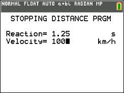
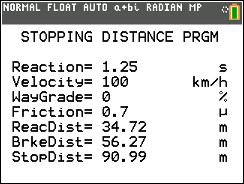
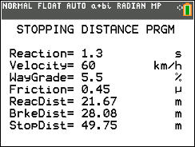

# Stopping Distance CE

Estimates reaction distance, braking distance, and total stopping distance from speed and road conditions.

## Compatibility and installation

Target: TI-84 Plus CE, using TI-BASIC. This import has not been tested on calculator hardware.

Transfer [STOPDISTCE.8xp](STOPDISTCE.8xp) with TI Connect CE, then run **STOPDIST** from the calculator’s PRGM menu. The transfer filename and the name shown on the calculator can differ.

## Usage

1. Enter driver reaction time in seconds.
2. Enter vehicle speed in km/h.
3. Enter road grade as a percentage: positive uphill, negative downhill, zero for level.
4. Enter a friction coefficient as a decimal.
5. Read reaction distance, braking distance, and their total.

## Notes

The original README includes illustrative reaction times and friction coefficients. Those values and its claims about “safe” distance are preserved as historical documentation, not validated guidance. This archive presents the program as an educational estimate.

## Screenshots

## Original documentation and release

- [readme.txt](docs/readme.txt)
- [Original ZIP](../../originals/Stopping%20Distance%20CE.zip)

The files above are preserved from the original release. This README is an archive guide; original documentation may contain older names, links, or claims.

## License

Covered by the repository’s [MIT license](../../LICENSE).
